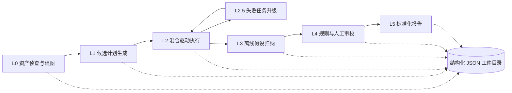
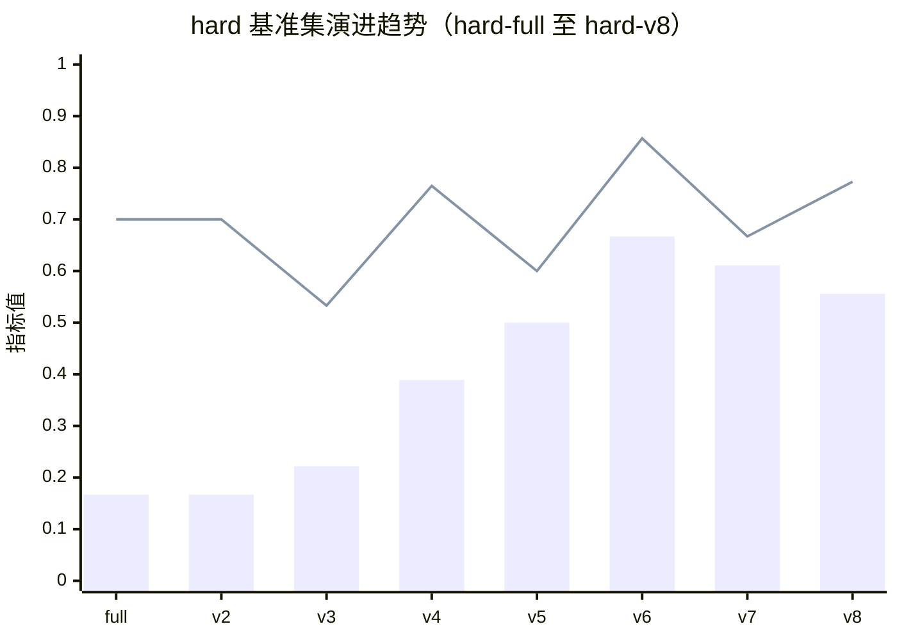
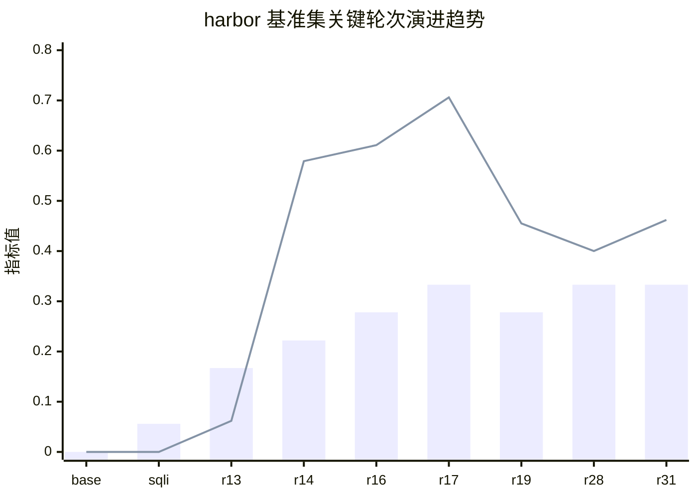
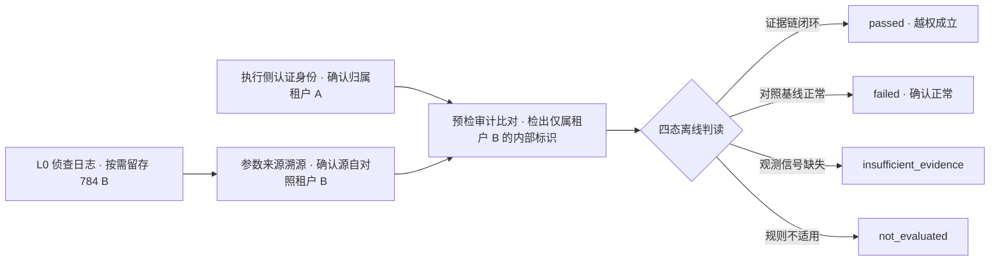

# WASP：面向复杂 Web 应用的混合式自动化安全验证框架阶段性进展报告

-success)

> **摘要**：本文汇报自动化 Web 应用安全评估框架 **WASP**（Web Application Security Pipeline）自 `v1.1` 至 `v1.8`（2026-10-25 至 2026-11-22）的阶段性研究与工程进展。WASP 采用**“大语言模型语义探索 + 确定性验证脚手架（Harness）”**的神经符号混合架构，全程在本地工作站闭环运行。在多梯度基准测试集上，系统于中等复杂基准（`hard`）取得 **66.7% 召回率 / 85.7% 有效精确率**，于大规模基准（`harbor`，185 个接口）实现召回率从 **0% 到 33.3%** 的持续攀升，并验证了零存储增量的跨租户离线证据链判读机制。

---

## 核心指标速览

| 评估维度 | 当前进展（v1.8） | 备注 |
|---|---|---|
| **`hard` 基准峰值表现** | 召回率 **66.7%**（12/18）｜有效精确率 **85.7%** | `hard-v6`（18 项基准缺陷 / 8 项对照陷阱） |
| **`harbor` 基准稳定表现** | 召回率 **33.3%**（6/18）｜有效精确率 **46.2%–70.6%** | 185 个接口；峰值精确率见 `r17`，稳定基线见 `r31` |
| **工程与测试规模** | 核心代码 **30,862 行**｜自动化验证脚本 **77 个** | 279 次提交；快档回归通过率 **77/81** |
| **本地端到端运行成本** | 单轮总耗时 **150.6 分钟**（9,038 秒） | L2 占 98.0%，其中模型推理占 78% |
| **离线证据链验证** | **V04 跨租户越权闭环通过**（`passed`） | 正文留存仅 **784 字节**，日志体积净增量为 **0** |

---

## 目录

- [1. 研究背景与核心范式](#1-研究背景与核心范式)
- [2. 系统架构与工程规模](#2-系统架构与工程规模)
- [3. 实验平台与基准评测体系](#3-实验平台与基准评测体系)
- [4. 量化实验进展](#4-量化实验进展)
- [5. 深度剖析：耗时瓶颈与混合架构分工](#5-深度剖析耗时瓶颈与混合架构分工)
- [6. 关键进展：基于数据溯源的离线证据链判读](#6-关键进展基于数据溯源的离线证据链判读)
- [7. 当前局限与下一阶段路线图](#7-当前局限与下一阶段路线图)

---

## 1. 研究背景与核心范式

复杂 Web 应用的安全缺陷往往隐含在多租户权限边界、跨接口状态机流转以及隐式业务不变量之中。面对此类场景，两类主流方案均存在结构性短板：

- **纯规则/静态扫描工具**：确定性高、开销低，但缺乏对业务语义和跨角色上下文的理解，难以识别深层逻辑与越权缺陷；
- **纯大语言模型（LLM）代理**：具备语义探索与假设推理能力，但在百级接口规模下容易出现上下文稀释、幻觉误报以及验证过程难以复现的问题。

**WASP** 探索了一条**神经符号协同（Neuro-Symbolic）**路径：由本地大语言模型负责语义理解与广度探索，由确定性工程脚手架（Harness）接管会话治理、协议规范化、可复现断言以及离线证据链审计，在保证数据本地闭环的前提下提升复杂应用安全验证的召回率与可信度。

---

## 2. 系统架构与工程规模

### 2.1 七层解耦流水线

WASP 将自动化安全评估拆解为七个职责独立的阶段。**层与层之间不共享内存状态，仅通过运行目录中的结构化 JSON 工件进行通信**，从而原生支持断点续跑、模块级回归与离线证据重判。

| 阶段 | 核心职责 | 输出定位 |
|---|---|---|
| **L0 侦查** | 接口发现、参数与数据流收集、多角色会话登录 | 应用拓扑与基线日志 |
| **L1 计划** | 基于侦查图谱推导安全不变量与候选验证任务 | 结构化测试计划 |
| **L2 执行** | LLM 语义探索与 Harness 确定性补充探测协同推进 | 交互轨迹与初步断言 |
| **L2.5 进阶** | 对受阻或高价值未决任务触发策略升级 | 增量执行记录 |
| **L3 假设** | 从失败与异常记录中离线提炼跨接口新假设 | 候选复测假设集 |
| **L4 审校** | 确定性规则裁决与人工复核确认 | 最终裁决状态 |
| **L5 报告** | 基于已核验证据链自动渲染结构化评估报告 | 交付级分析文档 |

### 2.2 工程体量与质量基线

- **迭代规模**：自 `v1.1`（2026-10-25）纳入版本控制至 `v1.8`（2026-11-21），累计完成 **279 次提交**，变更涉及 **223 个文件**（累计 `+45,755 / -8,959` 行）。
- **模块构成**：核心代码总计 **30,862 行**，其中流水线编排层（`pipeline/`）占 **11,546 行**，核心代理、断言与安全校验引擎（`mvp/`）占 **19,316 行**；内置 **16 类确定性验证断言**（覆盖访问控制、输入处理、状态流转、凭据暴露与安全配置）。
- **回归验证**：构建 **77 个**自动化验证脚本；全量快档回归通过率为 **77/81**（4 项失败均系本地外部向量嵌入服务未启动所致，核心逻辑测试全部通过），包含针对跨租户隔离与离线证据判读的 **76 项**专项验证用例。

---

## 3. 实验平台与基准评测体系

### 3.1 本地推理环境

全部实验均在单台本地工作站完成，验证高参数量模型在纯本地隐私可控环境下的工程可行性：

| 项目 | 规格与实测数据 |
|---|---|
| **硬件平台** | Apple Mac Studio（M3 Ultra 芯片，256 GB 统一内存） |
| **本地模型** | Q6_K 量化大语言模型（161 GB，5 分片），上下文窗口 **262,144 tokens** |
| **并发与加速** | 开启 MTP 投机解码（Speculative Decoding），2 槽并发推理 |
| **空闲吞吐量** | Prefill **407 tok/s** ｜ Eval（Decode）**41–52 tok/s** |
| **2 槽并发吞吐** | Eval（Decode）**23–24 tok/s** |

### 3.2 多梯度基准靶场

项目使用五套不同复杂度的受控本地基准集进行梯度评测，其中正向缺陷用于衡量**检出能力（Recall）**，防误报对照场景（Traps）用于检验**特异性与抗幻觉能力（Precision）**：

| 基准集 | 基准缺陷数（GT） | 防误报对照项（Traps） | 接口规模 | 评测角色 |
|---|---:|---:|---:|---|
| `easy` | 8 | 3 | — | 基础通路验证 |
| `medium` | 14 | 5 | — | 中等业务复杂度验证 |
| `hard` | 18 | 8 | — | 前期主力高难基准 |
| **`harbor`** | **18** | **8** | **185** | **本阶段主力大规模基准** |
| `vps` | 12 | 0 | — | 扩展场景补充 |

<strong>展开查看：主基准集 harbor 的 18 项安全不变量分类与 8 项防误报对照设计</strong>

#### 18 项基准安全不变量（按类别归类）

| 缺陷类别 | 数量 | 编号范围 | 代表性不变量要求 |
|---|---:|---|---|
| **对象级与跨租户访问控制** | 5 | V01–V05 | 私有项目/关联附件权限校验、作者级正文写权限、租户目录内部标识隔离、批量导出权限边界约束 |
| **业务工作流与状态机不变量** | 5 | V06–V10 | 提交人与审批人身份分离、状态前置条件校验、转账分录幂等性、服务端金额计算一致性、权限撤销后旧会话即时失效 |
| **输入处理与内容安全** | 5 | V11–V15 | 查询语句保持租户过滤条件、模板标题纯文本渲染、存储型与前端渲染型脚本隔离、归档读取目录边界限制 |
| **外部交互、凭据与身份认证** | 3 | V16–V18 | 外部回调禁止触达内部中继、服务账号凭据禁止下发至前端静态资源、令牌必须经服务端合法签名校验 |

#### 8 项防误报对照场景（TRAP01–TRAP08）

对照项涵盖：合法公开项目读取、非所属租户返回脱敏摘要、重复请求返回成功但实际幂等入账、无副作用的审批/回调/知识库预览接口、含特殊字符输入触发通用拦截错误，以及前端公开的拟态非敏感组件标识。

> [!IMPORTANT]
> **指标口径说明**：本报告中的**有效精确率（Effective Precision）**严格按照 $\text{TP} / (\text{TP} + \text{FP})$ 从结果分桶统计计算，与自动评分脚本中衡量“证据完整度”的覆盖率指标明确区分。

---

## 4. 量化实验进展

### 4.1 `hard` 基准集：快速跃升至 66.7% 召回率

在 `hard` 基准集的 8 轮迭代中（2026-11-11 至 11-12），系统召回率由基线 **0.167** 跃升至峰值 **0.667（12/18）**，同期有效精确率最高达到 **0.857**：

> 图注：柱状图为**召回率（Recall）**，折线图为**有效精确率（Effective Precision）**。

<strong>展开查看：hard 基准集 8 轮完整评测数据</strong>

| 轮次 | 日期 | 召回率 | 有效精确率 | Findings 数 | 命中真值数 |
|---|---|---:|---:|---:|---:|
| `hard-full` | 11-11 | 0.167 | 0.700 | 10 | 3 / 18 |
| `hard-v2` | 11-11 | 0.167 | 0.700 | 10 | 3 / 18 |
| `hard-v3` | 11-11 | 0.222 | 0.533 | 15 | 4 / 18 |
| `hard-v4` | 11-12 | 0.389 | 0.765 | 17 | 7 / 18 |
| `hard-v5` | 11-12 | 0.500 | 0.600 | 20 | 9 / 18 |
| **`hard-v6`** | **11-12** | **0.667** | **0.857** | **21** | **12 / 18** |
| `hard-v7` | 11-12 | 0.611 | 0.667 | 24 | 11 / 18 |
| `hard-v8` | 11-12 | 0.556 | 0.773 | 22 | 10 / 18 |

### 4.2 `harbor` 基准集：百级接口下的四阶段爬坡

切换至 185 个接口的 `harbor` 主基准集后，经过 22 轮系统迭代（2026-11-15 至 11-22），整体表现经历了“零检出 → 单点突破 → 快速爬坡 → 平台企稳”四个阶段：

> 图注：柱状图为**召回率（Recall）**，折线图为**有效精确率（Effective Precision）**。`harbor-r17` 取得当前综合峰值（Recall `0.333` / Effective Precision `0.706`）；最新轮次 `harbor-r31` 保持 `0.333` 召回率与 `0.462` 有效精确率。

#### 核心分析发现

1. **稳定覆盖的缺陷集合**：`r17` 之后，系统在工作流状态校验（V06、V07）、输入与渲染安全（V11、V13、V14）及前端凭据暴露（V17）6 项真值上形成了稳定的复现检出能力。
2. **真值外真实发现现象（Out-of-GT Real Findings）**：对 `harbor-r31` 的 14 条明细结果逐条复核发现：
   - **6 条**精确命中 18 项基准真值（V06、V07、V11、V13、V14、V17）；
   - **8 条**属于**客观存在但未列入 18 项基准真值集合的同源衍生问题或通用安全配置缺失**（包括同业务模块其他实例的审批/结算状态问题、同源评论区问题、安全响应头缺失，以及 1 条针对 V12 的部分命中）。
   - 这表明在严格 GT 评分口径下，上述真实衍生发现被计入了 FP 分母，导致账面有效精确率偏保守。
3. **跨规模泛化落差**：对比 `hard`（0.667）与 `harbor`（0.333），当接口规模扩展至 185 个后，剩余未命中项高度集中于**跨租户与对象级访问控制（V01–V05）**、**复杂业务数值/幂等/会话失效（V08–V10）**及**深层服务边界/签名校验（V15、V16、V18）**。

<strong>展开查看：harbor 基准集 22 轮完整评测日志（11-15 至 11-22）</strong>

| 轮次 | 日期 | 召回率 | 有效精确率 | Findings 数 | 命中真值 |
|---|---|---:|---:|---:|---|
| `harbor-base` | 11-15 13:50 | 0.000 | 0.000 | 1 | — |
| `harbor-pkg2` | 11-15 16:28 | 0.000 | 0.000 | 1 | — |
| `harbor-par` | 11-15 23:47 | 0.000 | 0.000 | 5 | — |
| `harbor-pf` | 11-16 01:21 | 0.000 | 0.000 | 4 | — |
| `harbor-role2` | 11-16 02:29 | 0.000 | 0.000 | 2 | — |
| `harbor-sqli` | 11-16 17:00 | 0.056 | 0.000 | 3 | V11 |
| `harbor-fid` | 11-16 20:14 | 0.056 | 0.000 | 6 | V11 |
| `harbor-full` | 11-16 21:35 | 0.056 | 0.000 | 6 | V11 |
| `harbor-r9` | 11-17 09:00 | 0.056 | 0.000 | 6 | V11 |
| `harbor-r11` | 11-17 12:55 | 0.056 | 0.000 | 6 | V11 |
| `harbor-r13` | 11-18 19:10 | 0.167 | 0.062 | 16 | V06, V11, V14 |
| `harbor-r14` | 11-18 21:02 | 0.222 | 0.579 | 19 | V06, V07, V11, V14 |
| `harbor-r15` | 11-18 23:13 | 0.222 | 0.625 | 16 | V06, V07, V11, V14 |
| `harbor-r16` | 11-19 01:05 | 0.278 | 0.611 | 18 | V06, V07, V11, V13, V14 |
| **`harbor-r17`** | **11-19 03:20** | **0.333** | **0.706** | **17** | **V06, V07, V11, V13, V14, V17** |
| `harbor-r18` | 11-19 07:50 | 0.222 | 0.500 | 10 | V07, V13, V14, V17 |
| `harbor-r19` | 11-19 09:31 | 0.278 | 0.455 | 11 | V07, V11, V13, V14, V17 |
| `harbor-r22` | 11-19 20:32 | 0.278 | 0.385 | 13 | V07, V11, V13, V14, V17 |
| `harbor-r28` | 11-20 22:38 | 0.333 | 0.400 | 15 | V06, V07, V11, V13, V14, V17 |
| `harbor-r29` | 11-21 21:07 | 0.333 | 0.400 | 15 | V06, V07, V11, V13, V14, V17 |
| `harbor-r30-lite` | 11-22 00:29 | 0.278 | 0.500 | 10 | V06, V11, V13, V14, V17 |
| **`harbor-r31`** | **11-22 11:08** | **0.333** | **0.462** | **13** | **V06, V07, V11, V13, V14, V17** |

---

## 5. 深度剖析：耗时瓶颈与混合架构分工

基于最新完整运行轮次 `harbor-r31` 的遥测数据，我们对 WASP 的计算资源消耗与组件分工进行了量化拆解。

### 5.1 耗时画像：98% 集中于 L2 长上下文 Prefill

`harbor-r31` 端到端总耗时 **9,038 秒（150.6 分钟）**，各阶段分布极度倾斜：

| 流水线阶段 | 耗时（秒） | 占比 | 分布示意 |
|---|---:|---:|---|
| **L2 混合执行** | **8,833.6** | **98.0%** | `███████████████████▌` |
| L0 资产侦查 | 168.4 | 1.9% | `▍` |
| L3 离线假设 | 36.1 | 0.4% | `▏` |
| L1 / L2.5 / L4 / L5 | 0.0 | 0.0% | ` ` |

进一步剖析 L2 阶段内部开销：
- **模型 vs. Harness**：模型总计时（含 2 槽排队）达 13,783 秒，折合实际计算时间约 **6,892 秒（占 L2 的 78%）**；确定性 Harness 占约 **1,942 秒（22%）**。
- **典型 Prefill 密集负载**：本轮共触发 **231 次大上下文请求**（> 2K tokens），**平均输入长度高达 17,200 tokens**，而平均生成长度仅 **550 tokens/次**。输入与输出 token 比例超过 **31 : 1**，意味着优化长上下文前缀复用与历史轨迹摘要，比单纯提升解码速度收益更大。

### 5.2 Harness 与模型的四维分工对比

统计 `harbor-r31` 全部 **415 次有效交互请求（Attempts）** 与 **14 条明细结论**，可以清晰看到神经符号架构下两个核心角色的不对称协同关系：

| 维度 | 确定性 Harness | 大语言模型（LLM） | 对比图示（Harness vs. LLM） |
|---|---:|---:|---|
| **工程代码量** | **73%** | 19% | `██████████████▌` vs `███▊` |
| **交互请求发起**（415 次） | 29%（122 次） | **71%**（293 次） | `█████▊` vs `██████████████▏` |
| **最终结论判定**（14 条） | **57%**（8 条） | 43%（6 条） | `███████████▍` vs `████████▋` |
| **运行时间开销** | 22% | **78%** | `████▍` vs `███████████████▌` |

<strong>展开查看：Harness 发起的 122 次请求与 14 条结论归因明细</strong>

- **Harness 发起请求细分（122 / 415，占 29.4%）**：
  - 预检探测（`preflight`）：82 次（19.8%）
  - 身份认证初始化（`auth_setup`）：17 次（4.1%）
  - 浏览器侧渲染验证（存储型 / 前端渲染型）：13 次（3.1%）
  - 状态变更动作验证（`state_change_action`）：6 次（1.4%）
  - 静态资源与安全头检查：4 次（0.9%）
- **结论归因细分（14 条）**：
  - Harness 确定性断言通过：7 条（50%）
  - Harness 确定性判正常：1 条（7%）
  - 模型独立判定（尚未接入确定性断言）：6 条（43%）

> [!TIP]
> **架构洞察**：大模型仅占 19% 的代码量，却主导了 71% 的探索交互并消耗了 78% 的运行时间；而确定性 Harness 沉淀了 73% 的工程代码，以 22% 的时间开销承担了 57% 的结论裁决。**将更多高频缺陷类别从“43% 无断言模型研判”迁移至“确定性断言闭环”**，是同步提升精确率与可复现性的核心杠杆。

---

## 6. 关键进展：基于数据溯源的离线证据链判读

针对跨租户访问控制类缺陷难以仅凭单次 HTTP 状态码或单次响应体裁决的问题，`v1.8` 建立了**四态离线确定性判读模型**，并在 `harbor-r31` 中完成了对 **V04（多租户目录越权）** 的端到端证据链闭环验证。

### 6.1 四态判读语义与 V04 验证闭环

| 判读状态 | 形式化含义 | `harbor-r31` 触发情况 |
|---|---|---|
| `passed` | 跨身份溯源与预检审计构成闭环，确认安全不变量被违背 | **命中 V04** |
| `failed` | 对照基线与响应特征完整，确认目标具备有效防护 | — |
| `insufficient_evidence` | 关键上下文或对照基线缺失，拒绝输出低置信结论 | — |
| `not_evaluated` | 当前测试场景不在该确定性判读规则适用范围内 | — |

### 6.2 零存储增量的轻量化留存设计

为了支持事后离线溯源而不引发日志膨胀，系统在 L0 阶段采用了精细化的按需正文留存策略：
- 在 `harbor-r31` 全部 **1,204 行** L0 日志中，仅保留了 **47 行**关键响应正文，**正文总大小仅 784 字节**；
- 整体运行日志体积从 `r29` 的 **685,842 字节** 反而下降至 `r31` 的 **660,051 字节**，实现了**磁盘空间零增量**条件下的完整跨租户证据链可追溯性。

---

## 7. 当前局限与下一阶段路线图

结合上述数据，WASP 下一阶段（`v1.9+`）将聚焦于三大核心工程与研究目标：

- [ ] **目标一：推广离线溯源判读，突破大规模基准召回瓶颈**  
  将 V04 已验证有效的“跨角色数据溯源 + 四态离线判读”范式体系化推广至其余对象级越权（V01–V03、V05）及复杂状态机/数值/会话不变量（V08–V10），推动 `harbor` 召回率向 `hard` 基准水平（> 60%）收敛。
- [ ] **目标二：治理 L2 长上下文 Prefill 开销，压缩端到端耗时**  
  针对平均 17.2K tokens 的大输入请求，引入任务级上下文隔离、历史轨迹结构化摘要与 KV Cache 前缀最大化复用，重点优化占总耗时 98% 的 L2 阶段，目标将单轮执行时间由 150 分钟量级大幅下探。
- [ ] **目标三：扩大确定性断言覆盖面，收窄主观研判比例**  
  补齐状态流转、非幂等重放与服务端模板求值等细分场景的确定性断言，将模型无断言结论占比从当前的 43% 持续压降；同时完善同源衍生发现的归并去重机制，进一步提升报告信噪比。

---

> [!NOTE]
> **对外发布声明**：本报告基于本地受控基准环境与研发度量数据整理而成，已对私有代码仓库地址、内部脚本路径、模型敏感标识及具体测试接口细节进行脱敏与学术化抽象，适用于阶段性技术交流与对外归档。
